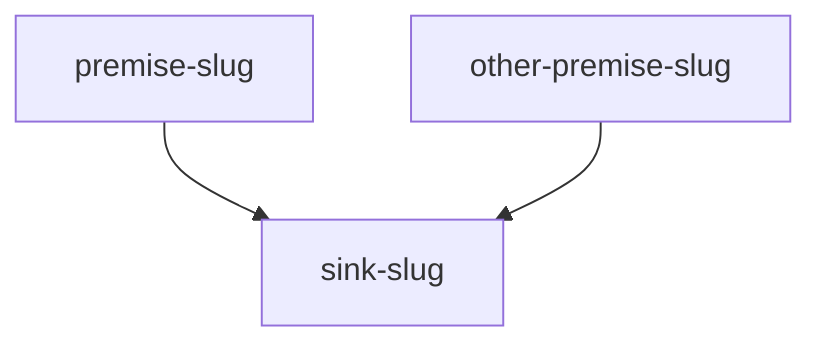

# The `.learn/` store

All state lives in `.learn/` at the project root. Skills read and write it only through the CLI, except the session markdown files below, which they write directly.

```
.learn/
  graph/
    nodes.jsonl            domain claims (true or attributed; never false statements)
    chains.jsonl           premises -> conclusion over node ids
    edits.jsonl            supersede / retract / contradicts
  learner/
    observations.jsonl     one line per question asked of the learner
    misconceptions.jsonl   false beliefs the learner holds (never in graph/)
    links.jsonl            session slug -> node or chain ids
  sessions/<YYYYMMDD-topic>/
    probe.md  grounding.md  plan.md  transcript.md  extraction.md
  sessions/<YYYYMMDD>-review/
    review.md
```

Rules for every file:

- JSONL files are append-only. Nothing rewrites or deletes a line. A correction is a new line.
- No mastery score, probability or percentage is stored. Status and due dates are derived by replay.
- Timestamps are ISO 8601 UTC with a `Z` suffix, second precision (`2026-11-09T22:19:00Z`).
- Ids are a type prefix plus 8 lowercase hex characters: `o-` observation, `m-` misconception, `n-` node, `c-` chain. `id` and `ts` are optional on every record; the CLI supplies them. A supplied `ts` must have the format above.
- Omit `id` when writing a new record. A supplied `id` must have its type's format. For an observation, node or chain it is rejected if it already exists (correct a node or chain with an edit). For a misconception it must already exist: that line updates it (the latest line wins).

## CLI

Call as `python3 <skills-dir>/_learn/scripts/learn.py [--root DIR] [--now TS] <subcommand> ...`. `--root` and `--now` go before the subcommand. `--root` is the project directory that contains `.learn`, and it wins over the `LEARN_ROOT` environment variable; without either, the CLI searches upward from the working directory. `init` creates the store in `--root`, else in `LEARN_ROOT`, else in the working directory. `--now` replaces the wall clock and must be a `YYYY-MM-DDTHH:MM:SSZ` timestamp. Every subcommand prints JSON on stdout, except `show`, which prints markdown. On failure it prints one line to stderr beginning with the offending field, flag or file, and exits 2. Every command reads the files it needs first, so a corrupt or wrong-shape line (`<file>:<line>: <reason>`) blocks it; a missing file is reported by name, and `learn.py init` (safe to repeat) recreates it.

### Observation (`learner/observations.jsonl`)

| Field | Required | Values |
|---|---|---|
| `session` | yes | non-empty string, the session directory name |
| `kind` | yes | `probe`, `check`, `review`, `final` |
| `form` | yes | `mc`, `free`, `predict`, `explain-why`, `apply`, `reconstruct`, `counterfactual`, `discriminate`, `teach-back`, `transfer` |
| `target` | yes | `{"type": "slug" \| "node" \| "chain", "id": str}` |
| `prompt` | yes | non-empty string |
| `expected` | yes | string or null; a non-empty string is required for kind `check`, `review`, `final` (pre-committed answer) |
| `response` | yes | string, the learner's words verbatim |
| `confidence` | yes | `low`, `med`, `high`, `not_given` |
| `grade` | yes | `took`, `missed`, `dont_know` |
| `produced` | yes | boolean; true when the learner generated the answer rather than picking or agreeing |
| `hinted` | no | boolean, default false |
| `lowEffort` | no | boolean, default false; set on the second and later bare option picks in a row (no reason, no confidence; the first stays as logged), and on a minimal answer that ends a probe for effort-drop |
| `misconception` | no | the `m-` id of an already-recorded misconception this answer shows again. A new wrong idea is recorded after its observation, with that `o-` id as evidence, so its observation carries no `misconception` field |

```
python3 learn.py --now 2026-11-09T22:19:00Z observe --json '{"session":"20261109-demo","kind":"check","form":"apply","target":{"type":"slug","id":"ready-to-hand"},"prompt":"What happens when the hammer breaks?","expected":"The hammer becomes conspicuous","response":"you notice it","confidence":"med","grade":"took","produced":true}'
```

### Misconception (`learner/misconceptions.jsonl`)

| Field | Required | Values |
|---|---|---|
| `statement` | yes | the false belief, non-empty |
| `counterpart` | yes | the correct statement, non-empty |
| `contradicts` | yes | list of node ids (may be empty) |
| `evidence` | yes | list of `o-` ids, at least one; at least two distinct ids when status is not `suspected` |
| `stability` | yes | `stable`, `shifting`, `one-off` |
| `kind` | yes | `category-error`, `missing-distinction`, `overgeneralized-fragment` |
| `status` | yes | `suspected`, `confirmed`, `addressed`, `resolved` |
| `session` | yes | non-empty string |

```
python3 learn.py misconception --json '{"statement":"A tool is first an object with properties","counterpart":"Equipment is encountered through use","contradicts":["n-4ef8ad36"],"evidence":["o-16a30b1a","o-f510948e"],"stability":"stable","kind":"category-error","status":"confirmed","session":"20261109-demo"}'
```

Statuses: `suspected` (inferred once), `confirmed` (a second, independent observation showed the same idea), `addressed` (its refute or discriminate check was passed in teaching), `resolved` (in a later sitting, an unhinted review pass on a node or chain in its `contradicts`, or on a chain whose conclusion is listed there). A miss that shows it again sets it back to `confirmed`. Every status but `suspected` needs two distinct evidence ids.

To read misconceptions, run `python3 learn.py misconceptions [--status confirmed]`: it prints a JSON list with the latest record per `id` (first-seen order), optionally filtered to one status. To update a misconception, read its current record with `misconceptions`, change the fields, and resubmit the whole record with the same `id`.

```
python3 learn.py misconceptions --status confirmed
```

### Node (`graph/nodes.jsonl`)

| Field | Required | Values |
|---|---|---|
| `name` | yes | kebab-case slug |
| `statement` | yes | one claim; rejected if it contains " because ", " therefore ", " hence " or " which means " (split it into nodes and a chain) |
| `claimType` | yes | `definition`, `result`, `attribution`, `consensus`, `interpretation` |
| `status` | yes | `source-verified`, `tutor-asserted`, `contested` |
| `source` | yes | string or null; required when status is `source-verified` or claimType is `attribution` |
| `scope` | yes | string or null; required for `interpretation` (according to which text or reading) |
| `session` | yes | non-empty string |

```
python3 learn.py node --json '{"name":"ready-to-hand","statement":"Equipment is encountered first through use, not through observation","claimType":"attribution","status":"source-verified","source":"Heidegger, Being and Time, section 15","scope":null,"session":"20261109-demo"}'
```

### Chain (`graph/chains.jsonl`)

| Field | Required | Values |
|---|---|---|
| `premises` | yes | list of existing node (`n-`) ids, at least one, no duplicates |
| `conclusion` | yes | an existing node id, not one of the premises |
| `session` | yes | non-empty string |

```
python3 learn.py chain --json '{"premises":["n-4ef8ad36"],"conclusion":"n-4f60bcde","session":"20261109-demo"}'
```

### Edit (`graph/edits.jsonl`)

The field `op` selects the shape. All ids must exist.

| `op` | Fields (all required) |
|---|---|
| `supersede` | `target`, `by` (different from `target`, same type: node by node, chain by chain), `reason`, `session` |
| `retract` | `target`, `reason`, `session` |
| `contradicts` | `a`, `b` (different from `a`), `reason`, `session` |

A supersede that would close a cycle (`by` already leads back to `target` through earlier supersedes) is rejected. A superseded or retracted node leaves the current graph. A chain whose premise or conclusion is retracted drops out; a superseded premise is replaced by its successor.

```
python3 learn.py edit --json '{"op":"supersede","target":"n-4f60bcde","by":"n-4ef8ad36","reason":"duplicate","session":"20261109-demo"}'
```

### Link (`learner/links.jsonl`)

Fields: `session`, `slug`, `targets` (list of existing `n-` or `c-` ids), and `reason` on a closing line. It ties plan slugs to graph ids so observations on a slug count toward those ids. Links accumulate: a later line for the same session and slug adds its targets to the earlier ones.

```
python3 learn.py link --session 20261109-demo --slug ready-to-hand --targets n-4ef8ad36,n-4f60bcde
```

A slug that gets no node (a strand probed but never taught, a claim dropped or contradicted by a source) is closed instead, with a reason. Its line has empty `targets`. A closed slug is never due and `show` does not list its session under "Not yet recorded". A later `link` with `--targets` reopens it, and its observations then count toward those ids. The reverse is rejected: `--none` on a slug that already has targets exits 2, because links accumulate and the targets would still win.

```
python3 learn.py link --session 20261109-demo --slug cartesian-subject --none --reason "probed strand, not taught this session"
```

### Read commands

```
python3 learn.py init                                          # create .learn/ (idempotent)
python3 learn.py candidates --statement "tools are encountered through use"   # [{"id","score"}], up to 5 active nodes, word overlap
python3 learn.py graph                                         # {"nodes": [...], "chains": [...]} current view
python3 learn.py observations --session 20261109-demo --target ready-to-hand   # observation lines as a JSON list
python3 learn.py state --target n-4ef8ad36                     # replayed state; omit --target for all
python3 learn.py --now 2026-11-12T00:00:00Z due --limit 8 --prefer n-4ef8ad36   # review queue
python3 learn.py --now 2026-11-12T00:00:00Z show               # learner model as markdown
```

`candidates` splits on any non-alphanumeric character and ignores words of three letters or fewer. `observations` prints every observation line in file order; `--session` keeps one session, `--target` keeps lines whose `target.id` equals the slug or `n-`/`c-` id given (a node's slug-linked history is under its slug). `due` returns up to `--limit` targets (default 8, at least 1); `--prefer` only orders, it does not filter: preferred ids first, then chains, then by earliest due date.

## Derived statuses and the ladder

`state` and `due` replay observations in timestamp order. Per target (an `n-` or `c-` id, or an unlinked slug), the CLI derives:

| Status | Meaning |
|---|---|
| `taught` | seen, but no unhinted produced pass after a delay |
| `retained` | an unhinted, produced `took` answer, on a probe or review first, or after a delay |
| `lapsed` | was `retained`, then a delayed `missed` or `dont_know` |
| `retracted` | the target, or a premise or conclusion of a chain, was retracted |
| `unlinked` | observations on a slug with no `link` yet; never due. Run `link` to count them |
| `closed` | a slug closed with `link --none --reason`; never due, not "Not yet recorded". A later `link` with targets reopens it |

Rules:

- A retrieval is delayed when at least 8 hours passed since the previous event on that target. Low-effort events still start the clock.
- Low-effort observations do not change status or rung.
- The first scored event sets the state: `retained` at rung 1 if it is a `probe` or `review` that was `took`, produced and unhinted; otherwise `taught` at rung 0.
- Later delayed events: a good answer moves up one rung (maximum 4) and sets `retained`; a miss moves down one rung (minimum 0) and, if `retained`, sets `lapsed`. Undelayed events change nothing.
- Review ladder in days by rung 0 to 4: 1, 3, 7, 21, 60. The next `due_at` is the event time plus the rung's interval. Review cap per sitting: 8 targets. The ladder, the cap and the 8-hour threshold are design defaults, not research findings.

## Session file templates

Each session directory is `.learn/sessions/<YYYYMMDD-topic>/`; a review sitting uses `.learn/sessions/<YYYYMMDD>-review/`. Keep these headings exactly.

### `probe.md` (learn-ground) and `review.md` (learn-review): pre-commitment

Write each question's block before the question is sent, and never quote either file in a message to the learner. Add the `Observation:` line once the reply is logged. `review.md` holds one section per sitting, appended; earlier sections are never edited.

```markdown
# Review <YYYY-MM-DDTHH:MM:SSZ>        (review.md only: one per sitting)
## Before                              (review.md only)
<the JSON printed by learn.py state at the start of the sitting, unchanged>
## Q<n>: <slug, or the n-/c- id under review>
Prompt: <the question as it will be sent>
Expected: <the answer it will be judged against>
Wrong models: <each likely wrong answer, or each multiple-choice option, and the wrong idea it embodies>
Observation: o-xxxxxxxx
```

### `grounding.md`

```markdown
## Goal
## Success criteria
1. <performance the learner will do unaided>
2. ...            (2-4 numbered performances)
## Strands
### <strand name>
- Status: bracketed | held-to-goal | partial | not-probed
- Floor: <what they reliably hold>
- Ceiling: <where it breaks>
- Floor quality: produced | recognised-only | fragile
- Evidence: o-xxxxxxxx, o-xxxxxxxx
## Misconceptions
- m-xxxxxxxx <statement>
## Session conditions
- Questions asked: <n>
- Stop reason: complete | budget | learner-request | effort-drop
- Strands not probed: <names or "none">
```

### `plan.md`

```markdown
## Goal in one paragraph
## Sources
<list, or the single line: Unverified: no sources available this session>
## Map

## Landmarks
| slug | claim | epistemic status | source | grounding status | move (attempt-first / assert / refute m-id / discriminate m-id, optionally + contrast) | check | expected answer | wrong models |
|---|---|---|---|---|---|---|---|---|
## Final tasks
- Teach-back (transcript closed): <prompt>. Scoring points: <...>
- Transfer: <question>. Scoring points: <...>
```

The map ends in a single sink landmark, the one every success criterion rests on. A landmark that covers the same claim as a grounding probe slug uses that slug. `grounding status` holds the strand status or `held (retrieve, do not re-teach)`, plus the `n-` id when the landmark reuses a store node; a held row still has its claim, check, expected answer, wrong models and the move to use if the cold check is missed. `refute` and `discriminate` name the misconception's `m-` id. A primary move may carry `+ contrast` (`attempt-first + contrast`). For `attempt-first`, the check is the attempt itself, asked before any explanation.

### `transcript.md`

One block per step, in order, then one `## Final tasks` block.

```markdown
## Step: <slug>
Move: <the plan's move, or held>
Expected: <answer written before the reply>
Wrong models: <named wrong answers and the misconception each indicates>
Explanation: <the claim in the tutor's own words, with its epistemic status>
Check: <question>
Confidence: low | med | high | not_given
Response: <learner's words verbatim>
Judgement: took | missed | dont_know, with one line of reasoning
Repair: <only after a miss: what the step assumes and what it predicts>
Observation: o-xxxxxxxx (check)
Observation: o-xxxxxxxx (re-ask)

## Final tasks
Recall: <the learner's free recall of the path>
Teach-back: Expected: <scoring points>; Response: <verbatim>; Judgement: <took | missed>; Observation: o-xxxxxxxx
Transfer: Expected: <scoring points>; Response: <verbatim>; Judgement: <took | missed>; Observation: o-xxxxxxxx
Feels obvious: <the learner's answer>, against the scores above
```

Every step that is started ends with `Explanation:` filled in. Lines follow the order things happened. On `assert`, `refute`, `discriminate` and repair steps `Explanation:` comes before `Check:`. On `attempt-first` the attempt is the check, so `Check:` through `Judgement:` come first and `Explanation:` (the consolidated claim) follows the judgement, whether the attempt took or missed. A held landmark that passed its cold check has `Explanation: none: held, passed cold`. A re-ask adds its own `Check:`, `Confidence:`, `Response:` and `Judgement:` lines. Each logged observation gets its own `Observation:` line with the `o-` id `observe` printed and what it was (check, re-ask, lagged recall of `<slug>`, explain-why).

### `extraction.md`

Each learn-record run appends one `# Run` section with these headings under it. A later run on the same session appends a new section and never rewrites an earlier one.

```markdown
# Run <YYYY-MM-DDTHH:MM:SSZ>
## Verification
- <claim>: checked against <source>; result: <confirmed | not found | contradicted>
## Proposed nodes and chains
- <slug>: <statement>; from <Explanation | Repair | plan claim (held)>
- chain <feeder slugs> -> <slug>: <kept | dropped: reason>
## Link decisions
- <proposed node>: candidates returned <ids or none>; decision: linked to <id> | created; reason: <one line>
## Learner review
- <what the learner contested>: <outcome>
## Written
- Nodes: n-...  Chains: c-...  Links: <slug> -> <ids>
- Closed: <slug>: <reason>
- Produced nothing: <landmark slug>: <reason>
```
